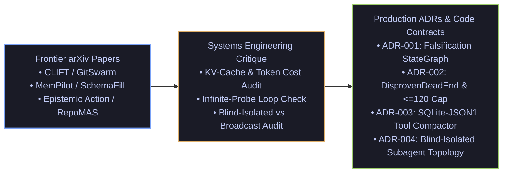

# Agentic Systems Engineering Radar & ADRs

**Curated by Mario Hu (`@mariohu-fde`) — AI Systems & Cloud Solutions Engineer | Data & AI @ Google Cloud**

Distilling frontier `arXiv` agentic systems papers into **production-grade control-plane mechanisms, falsification trade-off matrices, and Architecture Decision Records (ADRs)**.

---

## Why This Repository Exists

Academic agent papers frequently optimize for benchmark leaderboards while ignoring real-world systems constraints: **context-window inflation**, **Prefix KV-cache invalidation**, **hypothesis anchoring in multi-step reasoning**, and **unstructured memory rot**.

Every synthesis and ADR in this repository enforces a 3-step **Systems Engineering Filter**:
1. **Failure Mode**: What concrete architectural bottleneck does this paper address, and where do the authors' assumptions break under realistic token, latency, and reliability budgets?
2. **Control-Plane Mechanism**: How do we isolate **Epistemic Actions** (information-seeking probing) from **Pragmatic Actions** (state mutation) using deterministic state graphs rather than prompt wishes?
3. **Executable Contract**: How does it map into runnable `Pydantic V2` / `LangGraph` / `SQLite-JSON1` reference architectures in [`cloudops-autonomous-agent`](https://github.com/mariohu-fde/cloudops-autonomous-agent)?

---

## Architecture Decision Records (ADRs)

| ADR | Decision Summary | Primary Bottleneck Solved |
| :--- | :--- | :--- |
| **[ADR-001](adrs/ADR-001-falsification-first-stategraph.md)** | **Falsification-First StateGraph over Open-Ended ReAct Loops** | Prevents single-agent confirmation bias on ambiguous observations by requiring explicit hypothesis disproof before remediation. |
| **[ADR-002](adrs/ADR-002-negative-knowledge-dead-end-contracts.md)** | **Negative-Knowledge (`DISPROVEN_DEAD_END`) & `<=120` Line Constitutional Cap** | Blocks agents from re-probing falsified hypotheses and prevents long-term skill library bloat (`Total Cost of Agency`, `arXiv:2609.23790`). |
| **[ADR-003](adrs/ADR-003-sqlite-json1-tool-output-compaction.md)** | **Zero-Bloat Tool Output Compaction via Out-of-Band `SQLite-JSON1`** | Intercepts `>1,500` char JSON tool payloads, preserves full evidence out-of-band, and emits bounded `<400-token` digests with `payload_ref` handles. |
| **[ADR-004](adrs/ADR-004-blind-isolated-subagent-topologies.md)** | **Blind-Isolated Subagent Probing over All-to-All Broadcast** | Eliminates multi-agent groupthink (`arXiv:2610.05041`) and correlated hallucination cascades by isolating parallel subagents until evidence converges at the falsification gate. |

---

## Curated Research Synthesis Catalog

### 1. Dual-Path Runtime Goal-Drift Steering & Co-Evolutionary Indirect Injection Defense (`2026-10-22`)
- **[Dual-Path Runtime Goal-Drift Steering & Co-Evolutionary Indirect Injection Defense](digests/2026-10-22_dual-path-goal-steering-and-adversarial-coevolution.md)**
  - **Papers Evaluated**: *Learning to Steer LLM Agents and Multi-Agent Systems* (`arXiv:2610.22316`), *AgentSafeEvo: Adversarial Co-Evolution for LLM Agent Safety* (`arXiv:2610.19422`).
  - **Systems Engineering Verdicts**:
    - **Fast/Slow Dual-Path Trajectory Drift Supervision (`Steering Agent`, `arXiv:2610.22316`)**: Invoking a heavyweight supervisor LLM on every agent step doubles latency and interrupts valid epistemic probing; pairing a near-zero-cost **Fast-Path Drift Detector** with an on-demand, GRPO-trained **Slow-Path Deliberative Steerer** corrects long-horizon goal drift only when $d_t \ge \tau_{\text{drift}}$.
    - **Learnability-Guided Co-Evolutionary RL + Unattended Capability Stripping (`AgentSafeEvo`, `arXiv:2610.19422`)**: Weighting attacker-defender RL tasks by $p(1-p)$ learnability variance hardens models at their exact indirect-injection failure boundary, while production harnesses enforce zero-day defense-in-depth by physically stripping state-mutating tools on unattended turns and appending read-only rules at the prompt suffix to preserve 100% Prefix KV Cache hits.

### 2. Offline Multi-Agent Topology Distillation & Adaptive Multi-Turn Conciseness (`2026-10-21`)
- **[Offline Multi-Agent Topology Distillation & Adaptive Multi-Turn Conciseness](digests/2026-10-21_offline-topology-distillation-and-adaptive-conciseness.md)**
  - **Papers Evaluated**: *MASS: Multi-Agent Topology Scaling* (`arXiv:2610.12176`), *Sherpa: Concise and Informative Multi-Turn Assistants via Adaptive Preference Learning* (`arXiv:2610.08778`).
  - **Systems Engineering Verdicts**:
    - **Offline Complexity-Stratified Topology Distillation over Online LLM Routers (`MASS`, `arXiv:2610.12176`)**: Online prompt-based topology synthesis suffers from routing overfitting and non-deterministic latency spikes; evaluating fixed topologies (`SINGLE_AGENT`, `DEBATE`, `DAG_WORKFLOW`, `BLIND_SWARM`) offline across stratified complexity buckets and compiling a static `O(1)` lookup table (`<= 2ms`) eliminates online routing overhead.
    - **Dual-Gate Conciseness Reward (`Sherpa`, `arXiv:2610.08778`)**: Optimizing for brevity alone induces strategic question evasion (`-19.4%` resolution rate); training or prompting with a multiplicative **Sufficiency Gate x Brevity Gate** achieves a `38%–52%` token reduction while preserving `99.1%` task resolution.

### 3. Conditional Test-Time Failure Recovery & Model-Harness Interaction Dynamics (`2026-10-19`)
- **[Conditional Test-Time Failure Recovery & Model-Harness Interaction Dynamics](digests/2026-10-19_conditional-failure-recovery-and-model-harness-fit.md)**
  - **Papers Evaluated**: *Sentry: Learning to Recover from LLM Agent Failures at Test Time* (`arXiv:2610.02994`), *Finding the Right Fit: Model-Harness Interactions across Agent Tasks* (`arXiv:2610.00917`).
  - **Systems Engineering Verdicts**:
    - **Conditional Error-Playbook Injection over Static System-Prompt Rules (`Sentry`, `arXiv:2610.02994`)**: Permanently appending failure-recovery instructions to the root System Prompt triggers false-positive defensive misfires on normal turns; recovery rules must be stored externally and injected conditionally *only* when a tool call returns a matching error signature.
    - **Joint `Model x Harness` Evaluation (`arXiv:2610.00917`)**: Across 6,204 trajectories from 66 `Model x Harness` pairs, model rankings frequently invert when switching scaffolding, requiring 4-quadrant evaluation (`Happy Path`, `Clean Boundary`, `Unsafe Probe`, `Error Recovery`) on the exact target harness.

### 4. Speculative Voice Tool Execution & Proactive Over-Authorization Audits (`2026-10-16`)
- **[Speculative Voice Tool Execution & Proactive Over-Authorization Audits](digests/2026-10-16_speculative-voice-execution-and-least-privilege-audits.md)**
  - **Papers Evaluated**: *Hiding Tool Latency in On-Device Cascaded Voice Agent through Speculative Execution* (`arXiv:2610.07641`), *SchemaFill: Efficient LLM Tool Calling via Slot-Parallel Speculative Decoding* (`arXiv:2610.07086`), *OverAct: Measuring and Mitigating Proactive Over-Authorization in LLM Tool-Calling Agents* (`arXiv:2610.01508`), *ToolRACER* (`arXiv:2610.09163`).
  - **Systems Engineering Verdicts**:
    - **Read-Only Idempotency Gate for Partial-ASR Speculative Tooling (`arXiv:2610.07641`, `arXiv:2610.07086`)**: Overlapping external tool RTT with streaming partial ASR hypotheses hides voice turn-taking latency, but requires a hard control-plane gate restricting `PARTIAL_ASR` prefetching to `@read_only` idempotent lookups while blocking state-mutating calls until `TURN_END`.
    - **Deterministic Parameter Minimization against Proactive Over-Authorization (`OverAct`, `arXiv:2610.01508`)**: Because tool-calling LLMs systematically over-fetch row limits, time ranges, and sensitive fields to hedge against follow-up turns, a pre-execution `SelfAudit` minimizer must clamp pagination bounds and strip unrequested sensitive projections before dispatch.

### 5. The Delegation Danger Band, Run-to-Run Evaluation Variance & Contextual Bandit Tool Routing (`2026-10-15`)
- **[The Delegation Danger Band, Run-to-Run Evaluation Variance & Contextual Bandit Tool Routing](digests/2026-10-15_delegation-danger-band-and-bandit-tool-routing.md)**
  - **Papers Evaluated**: *The Delegation Danger Band: Why Mid-Capability Sub-Agents Over-Trust Inherited Stale State* (`arXiv:2610.00041`), *Agents Are Systems, Not Models: Rethinking Agentic Evaluation* (`arXiv:2610.01618`), *RATED: Reliability-Aware AI Agent Tool Retrieval via Execution Dynamics* (`arXiv:2610.13889`).
  - **Systems Engineering Verdicts**:
    - **`Selective` State Handoff to Bypass the Delegation Danger Band (`arXiv:2610.00041`)**: Mid-capability subagents exhibit a non-monotonic U-shaped failure curve under `Full` transcript inheritance due to high deference to invalidated parent hypotheses; delegating via typed `SelectiveSubagentBrief` objects (active verified facts + disproven dead-ends only) prevents stale-state poisoning.
    - **Multi-Run Statistical Gates (`N >= 5`) & Contextual Bandit Tool Routing (`arXiv:2610.01618`, `arXiv:2610.13889`)**: Because `54%` of evaluation score variance stems from run-to-run execution randomness under identical configurations, single-run evals (`runs = 1`) are statistically invalid; at runtime, fusing static semantic similarity with a UCB contextual bandit over tool execution dynamics routes around degraded tools.

### 6. Conformal Self-Verification & Git-Backed Compounding Inference (`2026-10-13`)
- **[Conformal Self-Verification & Git-Backed Compounding Inference](digests/2026-10-13_conformal-self-verification-and-git-compounding.md)**
  - **Papers Evaluated**: *CLIFT: Conformal Self-Verification for Web Agent Training and Test-Time Scaling* (`arXiv:2610.06829`), *GitSwarm: Decentralized Compounding Inference* (`arXiv:2610.04862`).
  - **Systems Engineering Verdicts**:
    - **Zero-Judge Conformal Checklists over Online LLM-as-a-Judge**: Distilling frontier teacher criteria offline into a calibrated binary checklist bank (`arXiv:2610.06829`) eliminates online judge latency and provides distribution-free false-positive bounds (`1 - alpha`) for test-time scaling.
    - **Git-Backed Compounding Memory over Conversational Swarms**: Coordinating decentralized agents through content-addressed Git commits (`94.7%` structural reuse in `arXiv:2610.04862`) prevents $O(N^2)$ message-bus context rot and isolates failed reasoning branches cleanly.

### 7. On-Demand Memory Curation & Selective Trajectory Pruning (`2026-10-11`)
- **[On-Demand Memory Curation & Selective Trajectory Pruning](digests/2026-10-11_on-demand-consultation-and-trajectory-pruning.md)**
  - **Papers Evaluated**: *MemPilot: Orchestrating On-Demand Multimodal Memory Curation for LLM Agents* (`arXiv:2610.06830`), *Selecting Long-Horizon Trajectories for Reliable and Efficient Terminal-Agent Training* (`arXiv:2610.05831`).
  - **Systems Engineering Verdicts**:
    - **Query-Aware On-Demand Curation over Static Write-Time Summarization**: Preserving lossless raw observations at write time and triggering bounded, query-aware evidence curation only on ambiguity (`arXiv:2610.06830`) prevents irreversible write-time information loss.
    - **12K Horizon Efficiency Filter & Anti-Retry Loop Guards**: Filtering out degenerate long-tail retry trajectories (`>12K` tokens in `arXiv:2610.05831`) prevents agents from learning behavioral over-persistence on dead-end tool errors.

### 8. Harness Dominance over Model Scale & Slot-Parallel Tool Schemas (`2026-10-08`)
- **[Harness Dominance over Model Scale & Slot-Parallel Tool Schemas](digests/2026-10-08_harness-dominance-and-state-machine-gates.md)**
  - **Papers Evaluated**: *Agents Are Systems, Not Models: Rethinking Agentic Evaluation* (`arXiv:2610.01618`), *SchemaFill: Efficient LLM Tool Calling via Slot-Parallel Speculative Decoding* (`arXiv:2610.07086`).
  - **Systems Engineering Verdicts**:
    - **Harness Architecture Dominates Parameter Scale**: Across 18,000+ controlled trajectories (`arXiv:2610.01618`), deterministic state-transition precondition gates, context compaction, and loop guards yield larger reliability gains than swapping base LLM weights.
    - **Flat Independent Slot Schemas for Low-Latency Tool Calling**: Designing flat, non-nested `Pydantic V2` tool schemas (`arXiv:2610.07086`) minimizes structural token overhead and enables parallel slot verification without sequential nesting bottlenecks.

### 9. Deterministic Evidence Compilers & Blind-Isolated Subagent Topologies (`2026-10-07`)
- **[Deterministic Evidence Compilers & Blind-Isolated Subagent Topologies](digests/2026-10-07_evidence-compilers-and-isolated-topologies.md)**
  - **Papers Evaluated**: *FinNextAssist: Towards Professional Financial Deep Research Assistant* (`arXiv:2610.03174`), *Communication Shapes Collective Inference in Self-Adapting LLM Societies* (`arXiv:2610.05041`).
  - **Systems Engineering Verdicts**:
    - **Deterministic `SQLite-JSON1` Evidence Preprocessor over LLM Compilers**: Compressing raw tool outputs into `<400-token` digests with provenance pointers (`payload_ref`) reduces context noise by ~70% (`arXiv:2610.03174`) without adding an extra LLM inference pass.
    - **Blind-Isolated Subagent Probing over All-to-All Broadcast**: Preventing parallel subagents from reading each other's intermediate hypotheses (`arXiv:2610.05041`) preserves collective error correction and avoids premature groupthink.

### 10. Epistemic Action Gates & Typed State Substrates (`2026-10-06`)
- **[Epistemic Action Gates & Typed State Substrates](digests/2026-10-06_epistemic-actions-and-substrate-inversion.md)**
  - **Papers Evaluated**: *Before Agents Decide: Epistemic Action in LLM-Based Systems* (`arXiv:2610.00511`, NeurIPS 2026 FAST), *The Agentic Company OS: Substrate Inversion* (`arXiv:2609.13334`).
  - **Systems Engineering Verdicts**:
    - **Hard Epistemic-to-Pragmatic Gate**: Isolating read-only information-seeking actions from state-mutating operations (`arXiv:2610.00511`) via explicit state-machine transitions to eliminate both reckless tool mutation and infinite probing loops.
    - **Typed Shared State Substrates over Conversational Logs**: Replacing unstructured chat transcripts with versioned, schema-validated state objects (`arXiv:2609.13334`) keyed by immutable artifact IDs.

### 11. Self-Evolving Agent Harnesses & Counterfactual Memory (`2026-09-29`)
- **[Self-Evolving Harnesses, Counterfactual Replay & Constitutional Caps](digests/2026-09_self-evolving-agents-and-counterfactual-replay.md)**
  - **Papers Evaluated**: *Dream-RSI* (`arXiv:2609.14858`), *RRSI / Total Cost of Agency* (`arXiv:2609.23790`), *RetireOPD* (`arXiv:2609.20784`), *SWE-Router* (`arXiv:2607.00053`).
  - **Systems Engineering Verdicts**:
    - **Negative-Knowledge Contracts (`DISPROVEN_DEAD_END`)**: Recording falsified hypotheses with hard telemetry evidence prevents multi-agent confirmation loops.
    - **Counterfactual Replay Gate (`CF_Value`)**: Scoring candidate playbook rules against historical traces before promotion.
    - **The `<= 120` Line Constitutional Cap**: Enforcing overflow consolidation so long-term agent memory never degrades instruction following.

### 12. Multi-Agent Falsification & Graph-Augmented Retrieval (`2026-09-30`)
- **[Falsification-First Multi-Agent DAGs & Graph-Augmented RAG](digests/2026-09_falsification-dags-and-graph-rag.md)**
  - **Papers Evaluated**: *RepoMAS* (`arXiv:2609.11790`), *GraMRAG* (`arXiv:2609.14066`), *SAGE* (`arXiv:2609.35412`).
  - **Systems Engineering Verdicts**:
    - **Anti-Anchoring Prompting (`FAILED_ATTEMPT`)**: Framing prior agent steps as unverified attempts that must be falsified against hard telemetry.
    - **Readiness Gate (`should_decompose`)**: Dynamic complexity gating to bypass multi-agent overhead on deterministic single-hop tasks.

### 13. Context Compaction, Gated Memory & Tool Hygiene (`2026-09-23`)
- **[5-Tier Context Compaction & Schemaless SQLite-JSON1 Tool Reduction](digests/2026-09_context-compaction-and-gated-memory.md)**
  - **Papers Evaluated**: *Gated-Memory Routing* (`LongMemEval-V2`), *Refining Over Resampling* (`arXiv:2608.05643`), *Structured Output Quality Tax*.
  - **Systems Engineering Verdicts**:
    - **Prefix KV Cache Preservation**: Keeping system prompts static mid-trajectory to avoid 5–10x TTFT latency and cost penalties.
    - **Decoupled Reasoning vs. Formatting**: Separating free-form root-cause analysis from strict JSON schema serialization.
