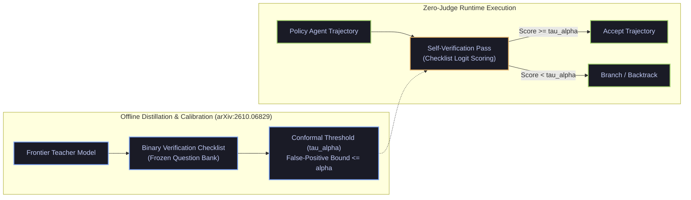

# Conformal Self-Verification (`arXiv:2610.06829`) & Git-Backed Compounding Inference (`arXiv:2610.04862`)

- **Date**: 2026-10-13
- **Curator**: Mario Hu (`@mariohu-fde`)
- **Primary Sources**:
  - *CLIFT: Conformal Self-Verification for Web Agent Training and Test-Time Scaling* (`arXiv:2610.06829`)
  - *GitSwarm: Decentralized Compounding Inference* (`arXiv:2610.04862`)
- **Architectural Focus**: Zero-Judge Conformal Self-Verification Checklists, Calibrated Test-Time Scaling, and Git-Backed Compounding Multi-Agent Memory

---

## 1. Conformal Self-Verification over Online LLM-as-a-Judge (`arXiv:2610.06829`)

### The Systems Problem: Online LLM-as-a-Judge Bottlenecks
Long-horizon autonomous agents frequently verify action outcomes at test time by invoking an external frontier LLM-as-a-Judge (`GPT-4o` / `Claude 3.5 Sonnet`) after every multi-step state transition. While online LLM judges improve task accuracy on benchmarks, they introduce three structural bottlenecks in agentic systems:
1. **Judge Inference Overhead**: Calling a frontier judge model after every candidate trajectory doubles end-to-end token cost and adds hundreds of milliseconds of serial latency per step.
2. **Uncalibrated Binary Verdicts**: Standard LLM-as-a-Judge prompts output uncalibrated natural-language confidence scores that suffer from severe false-positive drift on out-of-distribution states.
3. **Reward Hacking During RL**: Agents trained against a soft LLM judge rapidly learn to exploit superficial formatting cues rather than completing the underlying state transition.

### What `CLIFT` (`arXiv:2610.06829`) Proposes
*CLIFT* replaces online frontier judge calls with **Conformal Self-Verification**:
- **Offline Question-Bank Distillation**: A strong teacher model is used *only once offline* to synthesize a structured bank of verifiable, task-decomposed binary checklist questions (e.g., *"Does the current state payload contain a non-empty confirmation identifier matching the requested filter?"*).
- **Zero-Judge Test-Time Self-Verification**: At runtime, the policy model evaluates its own state observation against the pre-compiled binary checklist without invoking an external judge model.
- **Conformal Prediction Calibration**: Checklist pass scores are calibrated against a held-out calibration set via Conformal Prediction, providing distribution-free false-positive bounds (`1 - alpha`) for early stopping and test-time trajectory selection. Across WebArena-Lite (`57.0%`, `+5.2%`) and VisualWebArena (`38.2%`, `+4.2%`), `CLIFT` outperforms online LLM-as-a-Judge pipelines at a fraction of the inference cost.



---

## 2. Git-Backed Compounding Inference over Ephemeral Message Buses (`arXiv:2610.04862`)

### The Systems Problem: Ephemeral Swarm Context Rot
Most multi-agent test-time scaling frameworks coordinate agents via shared chat transcripts or ephemeral pub/sub message buses. As the number of agents or reasoning rounds grows, natural-language message passing causes $O(N^2)$ token amplification and loses intermediate partial proofs whenever a branch fails.

### What `GitSwarm` (`arXiv:2610.04862`) Proposes
*GitSwarm* replaces conversational agent coordination with **Decentralized Version-Controlled Artifact Compounding**:
- **Git-Native Coordination Protocol**: Agents operate asynchronously on a shared Git repository without a central orchestrator. Every intermediate lemma, diagnostic script, or verified sub-result is committed as an atomic, content-addressed file artifact.
- **Compounding Structural Reuse**: Subsequent agents inspect the commit graph, branch off verified partial artifacts, and merge non-conflicting discoveries. Across 80 multi-agent runs on FrontierMath (`65.2%`), IMO-ProofBench (`86.7%`), and PutnamBench (`91.7%`), `94.7%` of committed artifacts are directly reused by downstream agents, exhibiting super-linear performance gains as swarm size increases.

| Dimension | Conversational Multi-Agent Bus (`AutoGen` / Chat) | Git-Backed Compounding Inference (`arXiv:2610.04862`) |
| :--- | :--- | :--- |
| **State Substrate** | Append-only natural-language transcript | Content-addressed Git commit DAG of typed artifacts |
| **Context Growth** | $O(N^2)$ broadcast bloat across turns | $O(1)$ selective checkout of verified head artifacts |
| **Failure Recovery** | Failed branches pollute shared conversation history | Clean `git revert` / branch isolation without main-branch pollution |
| **Cross-Agent Reuse** | Implicit re-reading of unstructured text | `94.7%` explicit structural artifact reuse across commits |

---

## 3. Reference Implementation: Conformal Self-Verification & Artifact-Commit StateGraph

Below is a clean, self-contained `Pydantic V2` + `LangGraph` pattern combining `CLIFT`'s calibrated binary checklist verification (`arXiv:2610.06829`) with `GitSwarm`'s content-addressed artifact commit log (`arXiv:2610.04862`):

```python
import hashlib
from typing import Annotated, List, Literal, TypedDict
from pydantic import BaseModel, Field
from langgraph.graph import StateGraph, START, END


class ChecklistItemResult(BaseModel):
    """Single binary verification question from an offline-distilled CLIFT bank (arXiv:2610.06829)."""
    question_id: str
    passed: bool
    evidence_pointer: str = Field(description="Exact artifact hash or JSON path verifying this item")


class ConformalVerificationReport(BaseModel):
    """Calibrated self-verification gate with conformal threshold tau_alpha."""
    checklist_results: List[ChecklistItemResult]
    conformal_threshold: float = Field(default=0.85, ge=0.0, le=1.0)

    @property
    def empirical_score(self) -> float:
        if not self.checklist_results:
            return 0.0
        return sum(1 for item in self.checklist_results if item.passed) / len(self.checklist_results)

    @property
    def is_certified(self) -> bool:
        return self.empirical_score >= self.conformal_threshold


class CommittedArtifact(BaseModel):
    """Content-addressed artifact node inspired by GitSwarm (arXiv:2610.04862)."""
    commit_hash: str
    parent_hash: str | None
    author_agent: str
    artifact_type: Literal["HYPOTHESIS_PROOF", "VERIFIED_PATCH", "DISPROVEN_BRANCH"]
    content_summary: str

    @classmethod
    def create(
        cls,
        parent_hash: str | None,
        author_agent: str,
        artifact_type: Literal["HYPOTHESIS_PROOF", "VERIFIED_PATCH", "DISPROVEN_BRANCH"],
        content_summary: str,
    ) -> "CommittedArtifact":
        digest = hashlib.sha256(f"{parent_hash}:{author_agent}:{content_summary}".encode()).hexdigest()[:12]
        return cls(
            commit_hash=digest,
            parent_hash=parent_hash,
            author_agent=author_agent,
            artifact_type=artifact_type,
            content_summary=content_summary,
        )


def append_commits(
    existing: List[CommittedArtifact], new: List[CommittedArtifact]
) -> List[CommittedArtifact]:
    seen = {c.commit_hash for c in existing}
    return existing + [c for c in new if c.commit_hash not in seen]


class CompoundingAgentState(TypedDict):
    task_spec: str
    commit_dag: Annotated[List[CommittedArtifact], append_commits]
    latest_verification: ConformalVerificationReport | None
    backtrack_count: int


def conformal_verification_router(
    state: CompoundingAgentState,
) -> Literal["commit_to_main", "branch_backtrack", "abort_unverified"]:
    """Routes trajectories using calibrated conformal self-verification (arXiv:2610.06829)."""
    report = state.get("latest_verification")
    if report is not None and report.is_certified:
        return "commit_to_main"
    if state.get("backtrack_count", 0) >= 2:
        return "abort_unverified"
    return "branch_backtrack"
```
