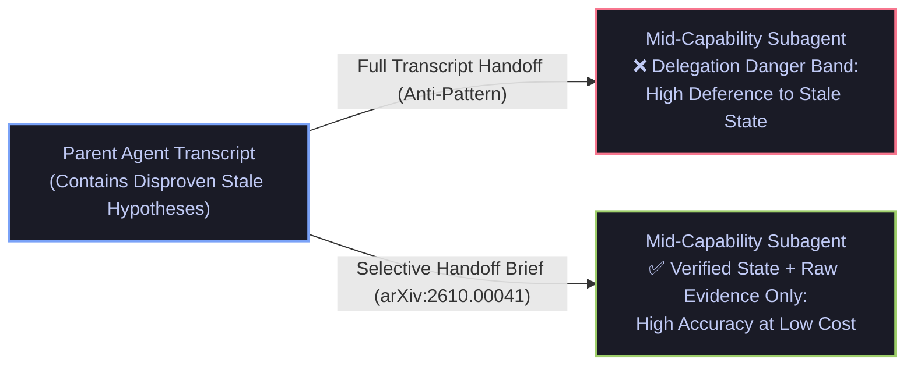

# The Delegation Danger Band (`arXiv:2610.00041`), Run-to-Run Evaluation Variance (`arXiv:2610.01618`) & Contextual Bandit Tool Routing (`arXiv:2610.13889`)

- **Date**: 2026-10-15
- **Curator**: Mario Hu (`@mariohu-fde`)
- **Primary Sources**:
  - *The Delegation Danger Band: Why Mid-Capability Sub-Agents Over-Trust Inherited Stale State* (`arXiv:2610.00041`, Jundong Hu & Shekar Ramachandran, PayPal AI)
  - *Agents Are Systems, Not Models: Rethinking Agentic Evaluation* (`arXiv:2610.01618`)
  - *RATED: Reliability-Aware AI Agent Tool Retrieval via Execution Dynamics* (`arXiv:2610.13889`, CIKM)
- **Architectural Focus**: Selective State Handoff for Lightweight Subagents, Multi-Run Evaluation Statistical Gates, and Contextual Bandit Tool Retrieval

---

## 1. The Delegation Danger Band in Multi-Agent State Handoff (`arXiv:2610.00041`)

### The Systems Problem: Implicit Full-Context Inheritance
When a supervisor or root agent delegates a subtask to a specialist subagent, orchestration frameworks commonly pass the parent's entire conversation history (`Full` inheritance) by default. In multi-turn diagnostic workflows, that history frequently contains early hypotheses or intermediate assumptions that were later disproven by fresh tool observations (**Stale State**).

### What `arXiv:2610.00041` Proves: The Non-Monotonic U-Shaped Vulnerability Curve
Comparing three state handoff protocols—`Reset` (raw observations only), `Selective` (curated active conclusions + verified evidence), and `Full` (complete parent transcript)—across varying subagent model capabilities $C_m$, Hu & Ramachandran uncover a striking **non-monotonic U-shaped failure curve (`The Delegation Danger Band`)**:
1. **Low-Capability Models ($C_m$ Low)**: Largely unaffected by stale state in `Full` transcripts because they lack the long-context integration capacity to attend to earlier conversational turns.
2. **Frontier Models ($C_m$ High)**: Highly robust; capable of cross-referencing raw tool outputs against inherited narrative claims and actively overriding invalidated parent hypotheses.
3. **Mid-Capability / Lightweight Models ($C_m$ Mid — The Danger Band)**: Experience a **sharp performance collapse** under `Full` context inheritance—often performing worse than weak models. Mid-capability models combine strong instruction/context adherence (**Deference**) with insufficient epistemic skepticism, causing them to blindly trust invalidated intermediate conclusions left in the parent's transcript while ignoring contradictory fresh evidence.



| Handoff Strategy | Payload Passed to Subagent | Impact on Mid-Capability Subagents (`arXiv:2610.00041`) | Token & KV-Cache Overhead |
| :--- | :--- | :--- | :--- |
| **`Full` (Default Chat Pass-Through)** | Complete parent conversation + obsolete turns | **Severe degradation (Danger Band)** due to deference to stale state | $O(T)$ full transcript replay per subagent |
| **`Reset` (Zero Context)** | Task prompt + raw initial inputs only | Avoids stale state bias but forces redundant re-probing | $O(1)$ prompt, high redundant tool calls |
| **`Selective` (Typed State Brief)** | **Active verified facts + explicit disproven dead-ends + raw evidence pointers** | **Optimal across all capability tiers ($C_m$)** | Bounded $O(1)$ structured state schema |

---

## 2. 54% Run-to-Run Evaluation Variance (`arXiv:2610.01618`) & Bandit Tool Routing (`arXiv:2610.13889`)

### 2.1 Why Single-Run Agent Benchmarks Are Statistically Meaningless (`arXiv:2610.01618`)
Performing a formal variance decomposition across task specifications, reasoning budgets, toolsets, and base models, *Agents Are Systems, Not Models* (`arXiv:2610.01618`) demonstrates that **under an identical model and harness configuration, approximately 54% of evaluation score variance originates from run-to-run execution randomness** (stochastic sampling paths interacting with non-deterministic tool outputs).Furthermore, task specification clarity accounts for a larger share of success variance than upgrading the underlying foundation model.
- **Systems Verdict**: Single-seed evaluation (`runs = 1`) is statistically indistinguishable from noise when validating prompt or harness diffs. Agent CI/CD pipelines must enforce multi-run evaluation gates (`N >= 5` independent trajectories per task) and evaluate pass@k / mean score confidence intervals before promoting changes.

### 2.2 Reliability-Aware Tool Retrieval via Contextual Bandits (`RATED`, `arXiv:2610.13889`)
Static semantic tool retrievers rank candidate tools purely by embedding similarity between the user query and tool docstrings. When an external API experiences transient latency spikes, rate limiting, or partial outages, static retrievers repeatedly hand the broken top-1 tool back to the agent.
- **Mechanism (`arXiv:2610.13889`)**: *RATED* fuses static semantic similarity $S_{\text{sem}}(q, t)$ with a **Contextual Bandit** tracking real-time execution dynamics (rolling success rate $\hat{p}_t$, latency penalty $L_t$, and uncertainty exploration bonus). Degraded tools are dynamically down-ranked in real time without mutating prompt instructions.

---

## 3. Reference Implementation: Selective Subagent Handoff & Bandit Tool Router

Below is a clean, self-contained `Pydantic V2` + `LangGraph` implementation combining **`Selective` Subagent State Handoff** (`arXiv:2610.00041`) with **Reliability-Aware Bandit Tool Ranking** (`arXiv:2610.13889`):

```python
import math
from typing import Dict, List, Literal, TypedDict
from pydantic import BaseModel, Field


class VerifiedFact(BaseModel):
    """Confirmed state observation safe for mid-capability subagent consumption."""
    fact_id: str
    statement: str
    evidence_ref: str
    is_superseded: bool = False


class SelectiveSubagentBrief(BaseModel):
    """Selective handoff contract preventing the Delegation Danger Band (arXiv:2610.00041)."""
    subtask_objective: str
    active_verified_facts: List[VerifiedFact]
    disproven_assumptions_to_ignore: List[str] = Field(
        default_factory=list,
        description="Explicit list of invalidated parent hypotheses that the subagent MUST NOT assume.",
    )

    @classmethod
    def from_parent_state(
        cls,
        subtask_objective: str,
        all_facts: List[VerifiedFact],
        disproven_claims: List[str],
    ) -> "SelectiveSubagentBrief":
        # Strip superseded/stale facts so mid-capability subagents never defer to obsolete state
        active_only = [f for f in all_facts if not f.is_superseded]
        return cls(
            subtask_objective=subtask_objective,
            active_verified_facts=active_only,
            disproven_assumptions_to_ignore=disproven_claims,
        )


class ToolExecutionStats(BaseModel):
    """Rolling execution dynamics for RATED contextual bandit routing (arXiv:2610.13889)."""
    tool_name: str
    semantic_similarity: float = Field(ge=0.0, le=1.0)
    success_count: int = 1
    failure_count: int = 0
    ema_latency_ms: float = 200.0

    def rated_ucb_score(self, total_invocations: int, alpha_sem: float = 0.6, c_explore: float = 0.15) -> float:
        n_t = self.success_count + self.failure_count
        empirical_reliability = self.success_count / n_t
        latency_penalty = min(0.3, self.ema_latency_ms / 10_000.0)
        ucb_bonus = c_explore * math.sqrt(math.log(max(1, total_invocations)) / n_t)
        return (
            alpha_sem * self.semantic_similarity
            + (1.0 - alpha_sem) * (empirical_reliability - latency_penalty)
            + ucb_bonus
        )


def rank_tools_with_execution_dynamics(candidates: List[ToolExecutionStats]) -> List[str]:
    """Ranks candidate tools by fusing semantic relevance with runtime reliability (arXiv:2610.13889)."""
    total_calls = sum(c.success_count + c.failure_count for c in candidates)
    ranked = sorted(
        candidates,
        key=lambda t: t.rated_ucb_score(total_invocations=total_calls),
        reverse=True,
    )
    return [t.tool_name for t in ranked]
```
