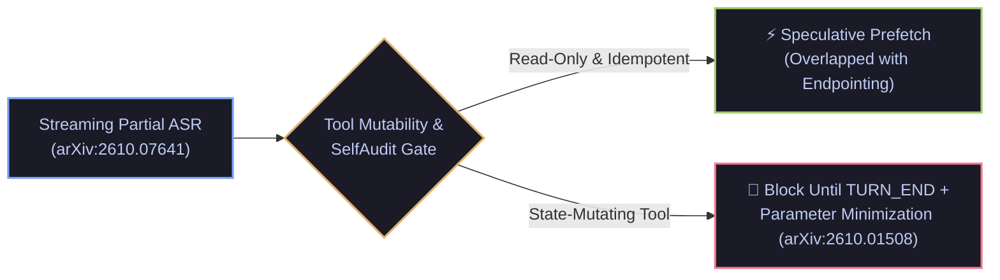

# Speculative Voice Tool Execution (`arXiv:2610.07641`) & Proactive Over-Authorization Audits (`arXiv:2610.01508`)

- **Date**: 2026-10-16
- **Curator**: Mario Hu (`@mariohu-fde`)
- **Primary Sources**:
  - *Hiding Tool Latency in On-Device Cascaded Voice Agent through Speculative Execution* (`arXiv:2610.07641`)
  - *SchemaFill: Efficient LLM Tool Calling via Slot-Parallel Speculative Decoding* (`arXiv:2610.07086`)
  - *OverAct: Measuring and Mitigating Proactive Over-Authorization in LLM Tool-Calling Agents* (`arXiv:2610.01508`)
  - *ToolRACER: Evaluating Multi-Turn Function Calling under Non-Cooperative and Revised User Constraints* (`arXiv:2610.09163`)
- **Architectural Focus**: Partial-ASR Speculative Tool Prefetching, Read-Only vs. Mutating Execution Gates, and Pre-Execution Parameter Minimization (`SelfAudit`)

---

## 1. Hiding Voice Agent Tool Latency via Speculative Execution (`arXiv:2610.07641` & `arXiv:2610.07086`)

### The Systems Problem: Serial Tool RTT in Cascaded Voice Pipelines
In cascaded voice agents (`Streaming ASR -> LLM Planner -> External Tool API -> TTS`), invoking an external tool after end-of-turn detection (`TURN_END`) directly adds hundreds of milliseconds of network round-trip time (RTT) plus autoregressive JSON parameter generation latency to Time-to-First-Audio (`TTFA`).

### Dual Latency-Hiding Mechanisms
1. **Partial-ASR Speculative Tool Execution (`arXiv:2610.07641`)**: Instead of waiting for final VAD endpointing (`TURN_END`), the runtime evaluates streaming **partial ASR hypotheses** during the tail end of user speech. When tool intent and slot confidence cross a threshold, the harness asynchronously prefetches the tool call while the user is still finishing their sentence, overlapping external API RTT with the endpointing window.
2. **Slot-Parallel Speculative Decoding (`SchemaFill`, `arXiv:2610.07086`)**: By exploiting the tree structure of tool JSON schemas, independent parameter slots are drafted and verified in parallel rather than sequentially token-by-token.

### Systems Engineering Critique: The Side-Effect Hazard
Speculative execution on partial speech hypotheses introduces a critical **Side-Effect Hazard**: a user may revise or negate their intent in the final 500ms of speech (*"Cancel order #402—actually wait, just check its shipping status"*).
- **Control-Plane Invariant**: Speculative prefetching on `PARTIAL_ASR` must be strictly restricted to **`@read_only` / idempotent query tools**. Any state-mutating tool (`POST`/`DELETE`/write operations) must be hard-blocked until `TURN_END` final transcript confirmation.



---

## 2. Mitigating Proactive Over-Authorization (`OverAct`, `arXiv:2610.01508`) & Slot Residue (`ToolRACER`, `arXiv:2610.09163`)

### 2.1 Why LLM Agents Proactively Over-Fetch (`arXiv:2610.01508`)
*OverAct* (`arXiv:2610.01508`) demonstrates that tool-calling LLMs systematically exhibit **Proactive Over-Authorization**: to maximize single-turn task completion and hedge against potential follow-up questions, agents autonomously request broader permission scopes, wider time ranges, higher row limits, and more sensitive fields than the user's prompt requires (e.g., invoking `fetch_records(limit=100, include_sensitive_pii=True)` when the user only asked for the timestamp of the single most recent item).
- **Mitigation (`SelfAudit`)**: Placing a pre-execution parameter minimization gate between LLM tool-call generation and tool dispatch—clamping `limit` bounds, projecting only prompt-justified fields, and stripping unrequested sensitive flags.

### 2.2 Multi-Turn Slot Residue under User Revisions (`ToolRACER`, `arXiv:2610.09163`)
*ToolRACER* (`arXiv:2610.09163`) evaluates multi-turn function calling when users change their mind or override constraints mid-conversation, revealing that agents frequently suffer from **Slot Residue Contamination**—retaining obsolete parameter values from earlier turns inside the final tool payload.

---

## 3. Reference Implementation: Speculative Read-Only Gate & Least-Privilege Parameter Minimizer

Below is a clean, self-contained `Pydantic V2` + `LangGraph` pattern combining **Partial-ASR Speculative Read-Only Dispatch** (`arXiv:2610.07641`) with **Deterministic Parameter Minimization (`OverAct` / `arXiv:2610.01508`)**:

```python
from typing import Any, Dict, FrozenSet, Literal
from pydantic import BaseModel, Field


class ToolSafetyContract(BaseModel):
    """Static control-plane metadata governing speculative execution and least privilege."""
    tool_name: str
    is_read_only_idempotent: bool = Field(
        description="True ONLY for side-effect-free GET/lookup tools safe for partial-ASR speculation."
    )
    max_allowed_limit: int = Field(default=10, ge=1, le=50)
    allowed_projection_fields: FrozenSet[str]
    sensitive_fields_requiring_explicit_intent: FrozenSet[str] = frozenset()


class ProposedToolInvocation(BaseModel):
    """Candidate tool call emitted by the planner on PARTIAL_ASR or TURN_END."""
    tool_name: str
    speech_phase: Literal["PARTIAL_ASR", "TURN_END"]
    user_utterance: str
    arguments: Dict[str, Any]


class AuditedToolDispatch(BaseModel):
    """Result of the combined Speculative + OverAct SelfAudit gate."""
    decision: Literal["DISPATCH_SPECULATIVE", "DISPATCH_COMMITTED", "HOLD_FOR_TURN_END", "REJECTED"]
    sanitized_arguments: Dict[str, Any]
    stripped_fields: list[str] = Field(default_factory=list)


def enforce_speculative_and_least_privilege_gate(
    proposal: ProposedToolInvocation,
    contract: ToolSafetyContract,
) -> AuditedToolDispatch:
    """
    1. Blocks state-mutating tools during PARTIAL_ASR (arXiv:2610.07641).
    2. Clamps over-fetched limits and strips unrequested sensitive fields (OverAct, arXiv:2610.01508).
    """
    if proposal.speech_phase == "PARTIAL_ASR" and not contract.is_read_only_idempotent:
        return AuditedToolDispatch(
            decision="HOLD_FOR_TURN_END",
            sanitized_arguments={},
        )

    sanitized = dict(proposal.arguments)
    stripped: list[str] = []

    # 1. Clamp proactive over-fetching on pagination limits
    if "limit" in sanitized and isinstance(sanitized["limit"], int):
        if sanitized["limit"] > contract.max_allowed_limit:
            sanitized["limit"] = contract.max_allowed_limit
            stripped.append(f"limit_clamped_to_{contract.max_allowed_limit}")

    # 2. Enforce least-privilege field projection (OverAct SelfAudit)
    if "fields" in sanitized and isinstance(sanitized["fields"], list):
        utterance_lower = proposal.user_utterance.lower()
        filtered_fields = []
        for field_name in sanitized["fields"]:
            if field_name not in contract.allowed_projection_fields:
                stripped.append(field_name)
                continue
            if (
                field_name in contract.sensitive_fields_requiring_explicit_intent
                and field_name.lower() not in utterance_lower
            ):
                stripped.append(field_name)
                continue
            filtered_fields.append(field_name)
        sanitized["fields"] = filtered_fields

    dispatch_mode = (
        "DISPATCH_SPECULATIVE" if proposal.speech_phase == "PARTIAL_ASR" else "DISPATCH_COMMITTED"
    )
    return AuditedToolDispatch(
        decision=dispatch_mode,
        sanitized_arguments=sanitized,
        stripped_fields=stripped,
    )
```
