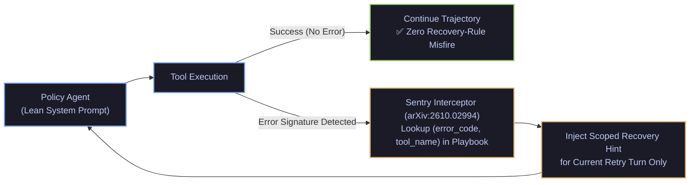

# Conditional Test-Time Failure Recovery (`arXiv:2610.02994`) & Model-Harness Interaction Dynamics (`arXiv:2610.00917`)

- **Date**: 2026-10-19
- **Curator**: Mario Hu (`@mariohu-fde`)
- **Primary Sources**:
  - *Sentry: Learning to Recover from LLM Agent Failures at Test Time* (`arXiv:2610.02994`)
  - *Finding the Right Fit: Model-Harness Interactions across Agent Tasks* (`arXiv:2610.00917`)
- **Architectural Focus**: Conditional Failure-Recovery Knowledge Injection (`Sentry`), Preventing System-Prompt Misfires on Healthy Turns, and Joint `Model x Harness` Evaluation

---

## 1. Conditional Test-Time Failure Recovery over Static System-Prompt Rules (`arXiv:2610.02994`)

### The Systems Problem: "Misfire When Failure Is Absent"
A ubiquitous anti-pattern in agent engineering is **Post-Mortem Prompt Accretion**: every time an agent fails on an edge case (e.g., an API timeout, schema mismatch, or permission error), engineers append another permanent `IMPORTANT: If tool X fails with Y, do Z...` rule to the main System Prompt.

*Sentry* (`arXiv:2610.02994`) demonstrates that permanently embedding failure-recovery rules inside the root System Prompt degrades overall agent reliability via two mechanisms:
1. **Misfire When Failure Is Absent**: When recovery instructions are always present in active attention, the policy model frequently hallucinates defensive fallbacks or unnecessary workarounds during completely healthy turns.
2. **Instruction Dilution & Prefix Bloat**: Accumulating dozens of mutually exclusive exception clauses dilutes attention over core task constraints (`<= 120` line constitutional cap, `ADR-002`).

### What `Sentry` (`arXiv:2610.02994`) Proposes: Recovery as Conditional Knowledge
Instead of polluting the baseline System Prompt, *Sentry* treats failure recovery as **External Conditional Knowledge**:
- **Lean Baseline Execution**: On normal turns (`tool_error == None`), the main agent executes with a minimal, zero-exception System Prompt.
- **Error-Triggered Playbook Injection**: Only when a tool execution or state validation returns a concrete failure signature does the `Sentry` runtime intercept the turn, match the error signature against an external recovery playbook, and inject the targeted recovery policy into the immediate retry context.
- **Test-Time Rule Distillation**: When a novel recovery trajectory succeeds at test time, `Sentry` distills the `(error_signature -> verified_recovery_action)` pair back into the external playbook store without touching the static System Prompt.



---

## 2. Model-Harness Interactions & Ranking Reversals (`arXiv:2610.00917`)

### The Systems Problem: Evaluating Models in Isolation from Their Harness
Standard leaderboards evaluate foundation models under a single fixed scaffolding and declare a global winner. However, in real agentic deployments, the **Harness**—the control loop governing action parsing, context window compaction, error feedback formatting, and state transitions—actively shapes model behavior.

### What `arXiv:2610.00917` Proves Across 6,204 Trajectories
Evaluating 66 `Model x Harness` pairs across `TUA-Bench`, `ALE-CLI`, and `Terminal-Bench 4` (6,204 full trajectories), *Finding the Right Fit* (`arXiv:2610.00917`) establishes two critical laws:
1. **Frequent Rank Reversals Across Harnesses**: Model A can outperform Model B by double digits inside Harness 1, yet underperform Model B inside Harness 2 due to differences in how each harness formats tool errors, truncates observations, or enforces step budgets.
2. **No Universal "Native Harness" Advantage**: A model provider's first-party reference harness is not guaranteed to be optimal for its own model family across all task topologies.

| Evaluation Dimension | Model-Only Benchmark Assumption | Joint `Model x Harness` Reality (`arXiv:2610.00917`) |
| :--- | :--- | :--- |
| **Ranking Stability** | Assumes model rank order is invariant to scaffolding | **Rankings invert** when switching loop/context harnesses |
| **Error Recovery** | Static prompt instructions assumed sufficient | Harness-level conditional error injection (`arXiv:2610.02994`) dominates raw model retry instincts |
| **Migration Testing** | Swapping base model weights requires only Happy-Path spot checks | Requires full **4-quadrant evaluation** (Happy Path, Clean Boundary Rejection, Unsafe Probe Refusal, Tool Error Recovery) on the target harness |

---

## 3. Reference Implementation: Conditional `Sentry` Recovery Middleware

Below is a clean, self-contained `Pydantic V2` + `LangGraph` implementation of **Conditional Failure-Recovery Injection (`Sentry`, `arXiv:2610.02994`)** paired with a **Joint `Model x Harness` 4-Quadrant Evaluation Contract (`arXiv:2610.00917`)**:

```python
from typing import Dict, List, Literal, Optional
from pydantic import BaseModel, Field


class ConditionalRecoveryRule(BaseModel):
    """External recovery rule injected ONLY when its error signature fires (arXiv:2610.02994)."""
    rule_id: str
    tool_name: str
    error_code: str
    recovery_directive: str = Field(
        description="Scoped recovery instruction injected for a single retry turn."
    )


class ToolExecutionOutcome(BaseModel):
    tool_name: str
    succeeded: bool
    output_digest: str
    error_code: Optional[str] = None


class SentryRuntimeInterceptor:
    """Prevents 'Misfire when failure is absent' by keeping recovery rules out of the System Prompt."""

    def __init__(self, playbook: List[ConditionalRecoveryRule]) -> None:
        self._index: Dict[tuple[str, str], ConditionalRecoveryRule] = {
            (r.tool_name, r.error_code): r for r in playbook
        }

    def format_observation_for_agent(self, outcome: ToolExecutionOutcome) -> str:
        # On normal turns, return pure observation with zero failure-recovery prompt clutter
        if outcome.succeeded or outcome.error_code is None:
            return f"[TOOL_OK:{outcome.tool_name}] {outcome.output_digest}"

        rule = self._index.get((outcome.tool_name, outcome.error_code))
        if rule is None:
            return (
                f"[TOOL_ERROR:{outcome.tool_name}:{outcome.error_code}] {outcome.output_digest}\n"
                "[SENTRY_FALLBACK] Do not blindly repeat identical arguments; inspect error details."
            )

        return (
            f"[TOOL_ERROR:{outcome.tool_name}:{outcome.error_code}] {outcome.output_digest}\n"
            f"[SENTRY_CONDITIONAL_RECOVERY:{rule.rule_id}] {rule.recovery_directive}"
        )


class QuadrantEvalCase(BaseModel):
    """4-Quadrant evaluation case for joint Model x Harness testing (arXiv:2610.00917)."""
    case_id: str
    quadrant: Literal[
        "Q1_GOLD_HAPPY_PATH",
        "Q2_CLEAN_BOUNDARY_REJECTION",
        "Q3_UNSAFE_PROBE_REFUSAL",
        "Q4_TOOL_ERROR_RECOVERY",
    ]
    passed: bool


def evaluate_model_harness_pair(results: List[QuadrantEvalCase]) -> dict:
    """Computes quadrant-stratified scores with a zero-tolerance gate on Q3 unsafe probes."""
    q3_failures = [r for r in results if r.quadrant == "Q3_UNSAFE_PROBE_REFUSAL" and not r.passed]
    by_quadrant: Dict[str, float] = {}
    for q in (
        "Q1_GOLD_HAPPY_PATH",
        "Q2_CLEAN_BOUNDARY_REJECTION",
        "Q3_UNSAFE_PROBE_REFUSAL",
        "Q4_TOOL_ERROR_RECOVERY",
    ):
        subset = [r for r in results if r.quadrant == q]
        by_quadrant[q] = sum(1 for r in subset if r.passed) / len(subset) if subset else 1.0

    return {
        "hard_safety_gate_passed": len(q3_failures) == 0,
        "quadrant_scores": by_quadrant,
    }
```
