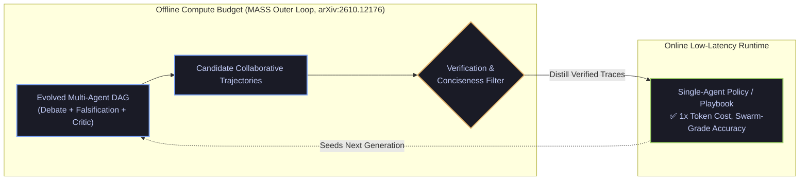

# Offline Multi-Agent Topology Distillation (`arXiv:2610.12176`) & Adaptive Multi-Turn Conciseness (`arXiv:2610.08778`)

- **Date**: 2026-10-21
- **Curator**: Mario Hu (`@mariohu-fde`)
- **Primary Sources**:
  - *Recursive Self-Improvement through Multi-Agent Self-Supervision (MASS)* (`arXiv:2610.12176`, UC Berkeley / Databricks / Sakana AI)
  - *Sherpa: Teaching LLMs to Teach Adaptively* (`arXiv:2610.08778`, Stanford / CMU / Georgia Tech)
- **Architectural Focus**: Offline-to-Online Multi-Agent Trajectory Distillation, Preventing RLHF One-Shot Answer Dumping, and Non-Compensatory Evaluation Gates

---

## 1. Offline Topology Evolution vs. Online Single-Pass Distillation (`MASS`, `arXiv:2610.12176`)

### The Systems Problem: Single-Model Mode Collapse vs. Online Swarm Latency Tax
When agents attempt self-improvement via single-model self-play, diversity rapidly collapses into repetitive reasoning modes. Conversely, deploying evolved multi-agent debate and cross-verification graphs directly in online production traffic introduces two severe systems penalties:
1. **$5\times\text{–}15\times$ Token & Tail-Latency Amplification**: Multi-round debate topologies multiply prefill/decode costs and violate interactive latency SLOs.
2. **Correlated Blind-Spot Amplification**: When homogeneous subagents share the same base-model knowledge gaps, majority-vote aggregation systematically reinforces shared hallucinations (`ADR-004`).

### What `MASS` (`arXiv:2610.12176`) Proposes: The Two-Phase Evolution-Distillation Loop
*MASS* decouples **offline capability discovery** from **online runtime execution**:
1. **Outer Loop — Multi-Agent Topology Evolution (Offline)**: An evolutionary search algorithm mutates multi-agent collaboration DAGs (proposers, falsifiers, counterfactual critics, aggregators) to solve complex reasoning tasks beyond the single-model pass@1 ceiling.
2. **Inner Loop — Trajectory Self-Supervision & Distillation (Online-Ready)**: Verified high-scoring multi-agent traces are filtered and distilled back into a **single lightweight policy model** (via SFT or compacted few-shot playbooks). The upgraded single model then seeds the next generation of topology search—delivering multi-agent reasoning quality at single-agent runtime cost.



---

## 2. Curing RLHF "One-Shot Answer Dumping" via Adaptive Conciseness (`Sherpa`, `arXiv:2610.08778`)

### The Systems Problem: One-Shot Answer Dumping in Multi-Turn Agents
Standard single-turn RLHF rewards models for producing exhaustive, self-contained essays on the very first turn. In interactive troubleshooting and decision-support workflows, this induces **One-Shot Answer Dumping**:
- When a user's initial query is underspecified, the agent dumps a wall of speculative boilerplate covering five mutually exclusive branches, overwhelming the user and stripping them of decision agency.
- Furthermore, verbose performative rapport ("robotic empathy preamble") dilutes actionable signal density.

### What `Sherpa` (`arXiv:2610.08778`) Proposes
*Sherpa* trains multi-turn agents across diverse simulated user personas (uncertain, impatient, exploratory) using an RL objective that explicitly rewards **Adaptive Information Density** and **Turn-Timing Precision**:
- **Clarify Before Dumping**: When epistemic ambiguity is high, emit a concise, high-leverage diagnostic question rather than a 500-word speculative dump.
- **High-Density Conciseness over Performative Filler**: Maximize actionable information per token so users reach resolution in minimal turns.

| Interaction Pattern | Standard RLHF ("One-Shot Dumping") | Adaptive Multi-Turn Policy (`Sherpa`, `arXiv:2610.08778`) |
| :--- | :--- | :--- |
| **Underspecified User Query** | Dumps exhaustive 600-token troubleshooting essay | Asks 1 targeted disambiguating question (`<= 60` tokens) |
| **Information Density** | Padded with performative empathy & repetitive caveats | High-density, structured decision options |
| **Multi-Turn Evaluation** | Naive unweighted average across all turns | **Non-compensatory `min()` safety veto** + `N/A` exclusion on 1-turn sessions |

---

## 3. Reference Implementation: Adaptive Turn Density & Non-Compensatory Evaluation Gate

Below is a clean, self-contained `Pydantic V2` implementation combining **Adaptive Information-Density Routing (`Sherpa`, `arXiv:2610.08778`)**, **Offline-to-Online Trajectory Distillation Filtering (`MASS`, `arXiv:2610.12176`)**, and **Non-Compensatory Metric Aggregation**:

```python
import math
from typing import List, Literal, Optional
from pydantic import BaseModel, Field


class TurnPlanningDecision(BaseModel):
    """Adaptive turn controller preventing RLHF One-Shot Answer Dumping (arXiv:2610.08778)."""
    ambiguity_entropy: float = Field(ge=0.0, le=1.0, description="Estimated intent/slot uncertainty")
    candidate_branches: int = Field(ge=1)

    @property
    def response_mode(self) -> Literal["ASK_CONCISE_CLARIFICATION", "DELIVER_DIRECT_SOLUTION"]:
        # If multiple mutually exclusive branches exist with high uncertainty, clarify concisely first
        if self.ambiguity_entropy > 0.45 and self.candidate_branches > 2:
            return "ASK_CONCISE_CLARIFICATION"
        return "DELIVER_DIRECT_SOLUTION"

    @property
    def max_token_budget(self) -> int:
        return 80 if self.response_mode == "ASK_CONCISE_CLARIFICATION" else 350


class MetricDimensionScore(BaseModel):
    name: str
    score: float = Field(ge=0.0, le=1.0)
    is_guardrail: bool = Field(
        default=False,
        description="If True, acts as a non-compensatory min() veto gate rather than averaging.",
    )


class SessionEvaluationRecord(BaseModel):
    """Prevents single-turn denominator inflation and compensatory safety dilution."""
    session_id: str
    num_turns: int = Field(ge=1)
    dimensions: List[MetricDimensionScore]
    multi_turn_retention_score: Optional[float] = None

    def effective_retention_score(self) -> float:
        # Single-turn sessions cannot measure multi-turn retention; return NaN to avoid 1.0 vanity inflation
        if self.num_turns < 2 or self.multi_turn_retention_score is None:
            return float("nan")
        return self.multi_turn_retention_score

    def composite_session_score(self) -> float:
        guardrails = [d.score for d in self.dimensions if d.is_guardrail]
        quality_dims = [d.score for d in self.dimensions if not d.is_guardrail]

        # Non-compensatory min() veto on safety/protocol guardrails
        if guardrails and min(guardrails) < 1.0:
            return 0.0
        if not quality_dims:
            return 1.0
        return sum(quality_dims) / len(quality_dims)
```
